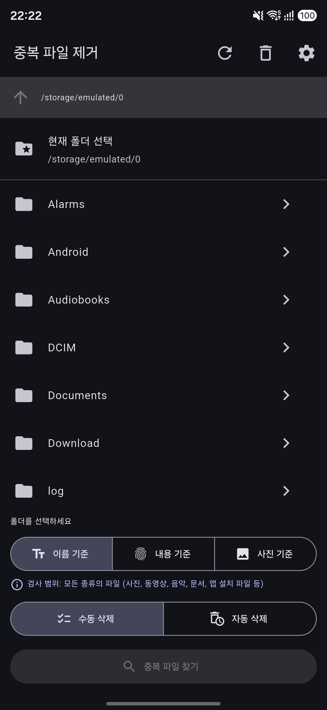
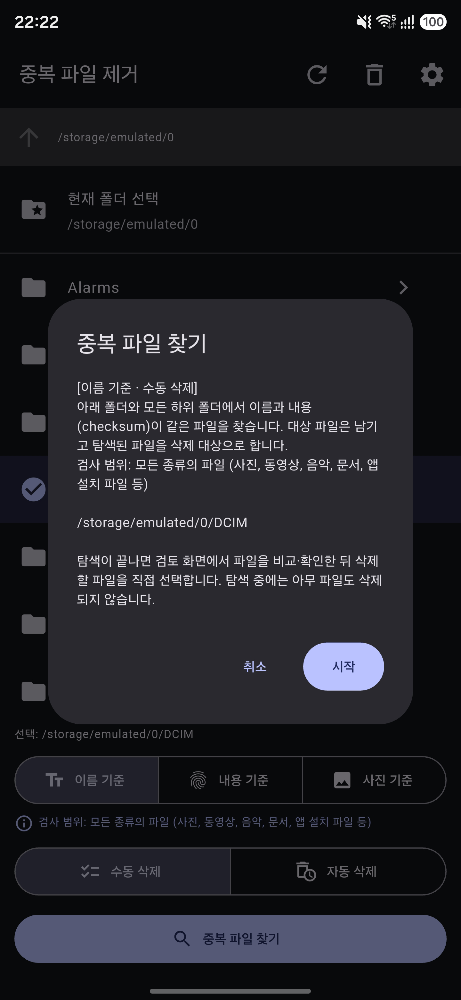
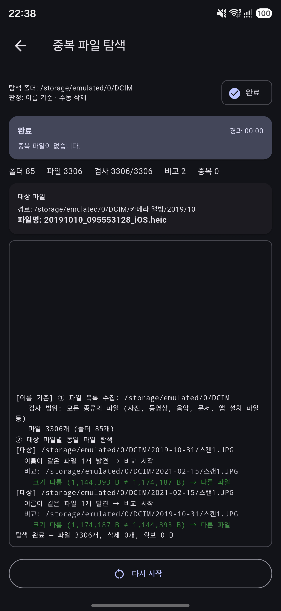
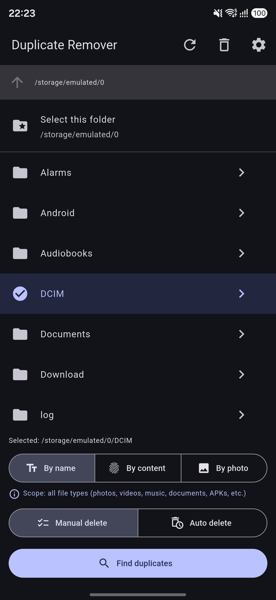
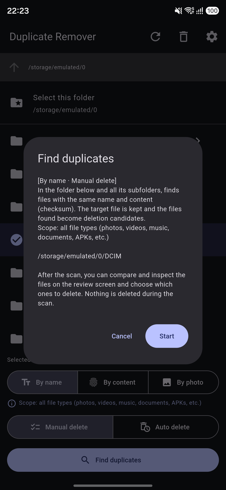
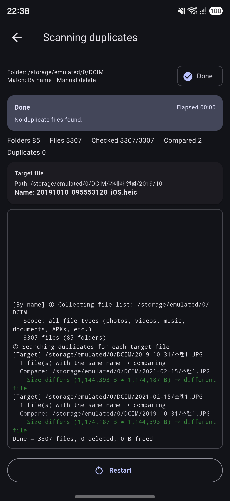

# 중복 파일 제거 (Duplicate File Remover)

Android 기기에서 중복 파일을 찾아 정리하는 앱입니다. 폴더를 고르면 그 아래 모든 하위 폴더를 탐색해 같은 파일을 찾습니다. 찾은 파일은 직접 비교해 보고 지울 수 있고, 지운 파일은 휴지통에 30일 동안 보관됩니다.

<a href="https://buymeacoffee.com/igna84" target="_blank"></a>

> [!WARNING]
> 이 앱은 기기의 파일을 **삭제합니다**. 사용하기 전에 중요한 파일(사진, 동영상, 문서 등)은 반드시 백업하세요.
> 이 소프트웨어는 **있는 그대로(AS IS)** 제공되며, 어떠한 보증도 하지 않습니다. 이 앱을 사용하다 파일이 유실되거나 손상되어도 개발자는 책임지지 않습니다.

---

## 스크린샷

<p>
  
  
  
</p>

## 주요 기능

- **폴더 단위 재귀 탐색**: 선택한 폴더 아래의 모든 하위 폴더를 끝까지 탐색합니다.
- **세 가지 판정 기준**

  | 판정 기준 | 중복으로 보는 경우 | 검사 범위 |
  |---|---|---|
  | 이름 기준 | 이름이 같고 checksum(MD5)도 같음 | 모든 종류의 파일 |
  | 내용 기준 | 이름은 달라도 내용(checksum)이 같음 | 모든 종류의 파일 (0바이트 파일 제외) |
  | 사진 기준 | JPEG에서 메타데이터(EXIF/GPS)와 모션 포토 동영상을 뺀 사진 데이터가 같음 | JPEG(.jpg, .jpeg)만 |

  - 내용 기준에서는 크기가 같은 파일만 비교합니다. 앞 64KB를 먼저 비교하고, 앞부분이 같을 때만 파일 전체를 읽습니다.
  - 사진 기준에서는 같은 사진 중 **모션 포토 > GPS 있음 > 일반 사진** 순서로 하나만 남깁니다.

- **두 가지 삭제 모드**
  - **수동 삭제 (기본)**: 탐색 중에는 아무것도 지우지 않습니다. 탐색이 끝나면 검토 화면에서 미리보기, 파일 정보 비교, 전체 화면 확대로 확인한 뒤 지울 파일을 직접 고릅니다. 그룹마다 최소 1개는 반드시 남습니다.
  - **자동 삭제**: 중복을 찾는 즉시 지웁니다. 시작하기 전에 경고를 보여주고 확인을 받습니다.
- **휴지통 (기본 삭제 방식)**
  - 지운 파일은 `.DuplicateRemoverTrash` 폴더로 옮겨 30일 동안 보관하며, 원래 위치로 복원할 수 있습니다.
  - 30일이 지난 파일은 앱을 실행할 때 자동으로 영구 삭제됩니다.
  - 옵션에서 "바로 영구 삭제"로 바꿀 수도 있습니다.
- **진행 상황 표시**: 지금 몇 단계인지, 얼마나 진행됐는지, 어떤 파일을 처리하고 있는지, 경과 시간과 비교 과정 로그를 보여줍니다.
- **정지 / 다시 시작**: 탐색 도중 언제든 멈출 수 있습니다.
- **한국어 / English** 지원

## 설치

### APK로 설치

1. 이 저장소의 **Releases** 페이지에서 최신 APK를 받습니다.
2. 기기에서 "출처를 알 수 없는 앱 설치"를 허용하고 설치합니다.
3. 처음 실행하면 주의사항에 동의하고, **"모든 파일 접근"** 권한을 허용합니다.

> 이 앱은 Google Play에 등록되어 있지 않습니다. 모든 파일 접근 권한이 꼭 필요한 구조라서, 소스 코드와 APK로만 배포합니다.

### 소스에서 빌드

필요한 것: [Flutter](https://docs.flutter.dev/get-started/install) (stable), Android SDK, JDK 17 이상

```bash
flutter pub get
flutter run                 # 연결된 기기에서 실행
flutter build apk --release # APK 빌드
```

### 테스트

```bash
flutter test test
```

## 권한

| 권한 | 용도 |
|---|---|
| `MANAGE_EXTERNAL_STORAGE` (모든 파일 접근, Android 11+) | 선택한 폴더의 파일 탐색, 삭제, 휴지통 이동 |
| `READ/WRITE_EXTERNAL_STORAGE` (Android 10 이하) | 같은 용도 |

파일 정보는 기기 안에서만 처리하며, 어떤 데이터도 외부로 보내지 않습니다. 인터넷 권한도 쓰지 않습니다.

## 알려진 제한 사항

- 다시 압축된 사진이나 동영상(메신저로 받은 사진, 리사이즈한 사진, 편집 후 저장한 파일)은 내용이 달라서 중복으로 찾지 못합니다.
- 사진 기준은 JPEG만 지원합니다. HEIC와 PNG는 검사하지 않습니다.
- 휴지통 방식에서는 휴지통을 비우거나 30일이 지나야 저장 공간이 실제로 늘어납니다.
- 앱을 삭제해도 휴지통 폴더(`.DuplicateRemoverTrash`)는 기기에 남을 수 있습니다.
- 검토 화면에서 동영상은 썸네일 없이 아이콘으로만 표시됩니다.

## 프로젝트 구조

```
lib/
  main.dart                     앱 진입점 (주의사항 동의 확인)
  src/
    duplicate_scanner.dart      탐색, 비교, 삭제 로직 (별도 Isolate에서 실행)
    jpeg_info.dart              JPEG 분석 (사진 데이터 해시, 모션 포토/GPS 확인)
    trash_store.dart            앱 전용 휴지통
    scan_runner.dart            Isolate 실행과 정지
    directory_browser_page.dart 폴더 선택 화면
    scan_page.dart              진행 화면
    review_page.dart            검토와 비교 화면 (수동 삭제)
    trash_page.dart             휴지통 화면
    settings_page.dart          옵션 (언어, 삭제 방식, 버전)
    disclaimer_page.dart        주의사항 및 면책 조항
    l10n/strings.dart           한국어/영어 문구
tool/render_icons_test.dart     앱 아이콘과 스플래시 원본 생성기
```

### 아이콘과 스플래시 다시 만들기

```bash
flutter test tool/render_icons_test.dart     # assets/icon, assets/splash PNG 생성
dart run flutter_launcher_icons              # Android 아이콘 적용
dart run flutter_native_splash:create        # 스플래시 적용
```

## 라이선스

[MIT License](LICENSE)로 배포합니다. 자유롭게 사용, 수정, 배포할 수 있으며, 저작권 표시와 라이선스 전문을 함께 포함해야 합니다.

---

## English

An Android app that finds and cleans up duplicate files on your device. Pick a folder and it scans every subfolder beneath it for identical files. You can compare the duplicates yourself before deleting them, and deleted files are kept in a trash for 30 days.

> [!WARNING]
> This app **deletes files** on your device. Always back up important files (photos, videos, documents, etc.) before use.
> This software is provided **"AS IS"**, without warranty of any kind. The developer is not responsible for any loss of or damage to files caused by using this app.

### Screenshots

<p>
  
  
  
</p>

### Features

- **Recursive folder scan**: scans every subfolder under the selected folder, all the way down.
- **Three match modes**

  | Match mode | Treated as duplicate when | Scope |
  |---|---|---|
  | By name | Same name and same checksum (MD5) | All file types |
  | By content | Same content (checksum), even with different names | All file types (0-byte files excluded) |
  | By photo | Same JPEG image data after stripping metadata (EXIF/GPS) and motion photo video | JPEG only (.jpg, .jpeg) |

  - In content mode, only files of the same size are compared. The first 64 KB is compared first, and the whole file is read only if those match.
  - In photo mode, only one copy of each photo is kept, preferring **motion photo > photo with GPS > plain photo**.

- **Two delete modes**
  - **Manual (default)**: nothing is deleted during the scan. When the scan finishes, the review screen lets you check files with previews, side-by-side file info, and full-screen zoom, then choose which ones to delete. At least one file in every group is always kept.
  - **Auto**: duplicates are deleted as soon as they are found. A warning is shown and confirmation is required before starting.
- **Trash (default delete method)**
  - Deleted files are moved to the `.DuplicateRemoverTrash` folder, kept for 30 days, and can be restored to their original location.
  - Files older than 30 days are permanently deleted automatically when the app starts.
  - You can switch to "Delete permanently" in the settings.
- **Progress display**: shows the current stage, overall progress, the file being processed, elapsed time, and a log of the comparison process.
- **Stop / restart**: you can stop a scan at any time.
- **Korean / English** supported

### Installation

#### Install the APK

1. Download the latest APK from the **Releases** page of this repository.
2. Allow "Install unknown apps" on your device and install it.
3. On first launch, accept the disclaimer and grant the **"All files access"** permission.

> This app is not on Google Play. Because it fundamentally requires all files access, it is distributed only as source code and APK.

#### Build from source

Requirements: [Flutter](https://docs.flutter.dev/get-started/install) (stable), Android SDK, JDK 17 or later

```bash
flutter pub get
flutter run                 # run on a connected device
flutter build apk --release # build the APK
```

#### Tests

```bash
flutter test test
```

### Permissions

| Permission | Purpose |
|---|---|
| `MANAGE_EXTERNAL_STORAGE` (All files access, Android 11+) | Scanning, deleting, and moving files to trash in the selected folder |
| `READ/WRITE_EXTERNAL_STORAGE` (Android 10 and below) | Same as above |

File information is processed only on the device, and no data is sent anywhere. The app does not even use the internet permission.

### Known limitations

- Re-compressed photos or videos (received via messengers, resized, or re-saved after editing) have different content and are not detected as duplicates.
- Photo mode supports JPEG only. HEIC and PNG are not checked.
- With the trash method, storage space is actually freed only after emptying the trash or after 30 days.
- The trash folder (`.DuplicateRemoverTrash`) may remain on the device after uninstalling the app.
- On the review screen, videos are shown as an icon without a thumbnail.

### Project structure

```
lib/
  main.dart                     App entry point (checks disclaimer consent)
  src/
    duplicate_scanner.dart      Scan, compare, and delete logic (runs in a separate Isolate)
    jpeg_info.dart              JPEG analysis (image data hash, motion photo/GPS detection)
    trash_store.dart            App-specific trash
    scan_runner.dart            Isolate launch and stop
    directory_browser_page.dart Folder picker screen
    scan_page.dart              Progress screen
    review_page.dart            Review and compare screen (manual delete)
    trash_page.dart             Trash screen
    settings_page.dart          Settings (language, delete method, version)
    disclaimer_page.dart        Disclaimer
    l10n/strings.dart           Korean/English strings
tool/render_icons_test.dart     Generator for app icon and splash source images
```

#### Regenerating the icon and splash

```bash
flutter test tool/render_icons_test.dart     # generate PNGs in assets/icon, assets/splash
dart run flutter_launcher_icons              # apply Android icons
dart run flutter_native_splash:create        # apply splash screen
```

### License

Distributed under the [MIT License](LICENSE). You are free to use, modify, and distribute it, provided the copyright notice and license text are included.

If you find it useful, you can [buy me a coffee ☕](https://buymeacoffee.com/igna84).
